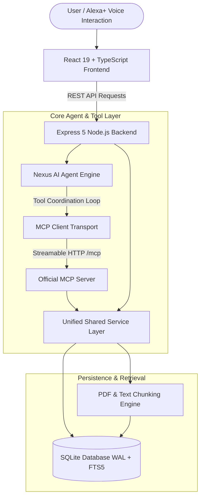

# Nexus AI - Architecture Specification

> **Track**: Amazon Developer Hackathon 2026 - Alexa+  
> **Tagline**: *One Conversation. Multiple Tools. Real-World Actions.*

---

## 1. System Overview

Nexus AI is a full-stack, context-aware AI productivity agent designed around the **Model Context Protocol (MCP)** specification (Version `2025-11-25`). Unlike simple chatbots or disconnected UI prototypes, Nexus AI coordinates a full-featured backend, persistent SQLite database with Full-Text Search (FTS5), and an official TypeScript MCP server communicating over **Streamable HTTP Transport**.

---

## 2. Core Architectural Pillars

### A. Frontend Layer
- **Framework**: React 19 + TypeScript + Vite.
- **Styling Architecture**: Pure CSS Tokens & CSS Modules (`theme.css`) with zero Tailwind CSS dependency.
- **Aesthetic Direction**: Dark-first palette (`#080b11` base, `#121826` cards, `#10b981` emerald accent, `#06b6d4` teal accent), high contrast, micro-interactions.
- **Navigation & Views**:
  - `Overview`: Real application metrics, recent tasks, study timeline, and audit activity.
  - `AI Assistant Workspace`: Full chat stream with tool status cards, interactive schedule approval card, and quiz launcher.
  - `Knowledge Base`: Document drag-and-drop, PDF parsing, chunk inspection, and FTS5 search.
  - `My Tasks`: Full CRUD with priority levels, deadlines, estimated duration, and delete safeguards.
  - `Smart Planner`: Daily timeline, time-blocked study sessions, 15-minute restorative breaks, and conflict detection.
  - `Quizzes`: Interactive MCQ quiz player, automatic score calculation, answer rationales, and attempt logs.
  - `Activity History`: Chronological audit trail of all MCP tool invocations.
  - `Settings`: User routine preferences and live MCP diagnostics.

### B. Application Backend & Shared Service Layer
- **Runtime**: Node.js v24 (ESM native).
- **Web Server**: Express 5.
- **Unified Services**: Both the REST endpoints and the MCP tools execute through the **same shared service layer**, ensuring zero duplication of business logic:
  - `TaskService`: CRUD operations, priority filtering, and completion stats.
  - `DocumentService`: PDF/text normalization, sliding-window chunking (120 words with 25-word overlap), and FTS5 retrieval.
  - `ScheduleService`: Intelligent session allocation, rest interval insertion, overlap/conflict detection, and approval policy.
  - `QuizService`: Multi-choice question generation, answer evaluation, scoring, and attempt tracking.
  - `PreferenceService`: Key-value configuration persistence.
  - `ActivityService`: Audit event logging.

### C. Genuine MCP Server
- **SDK**: Official `@modelcontextprotocol/sdk` (v1.32.1).
- **Transport**: `StreamableHTTPServerTransport` mounted at `/mcp`.
- **Protocol Version**: `2025-11-25`.
- **Tool Suite**: 17 explicitly implemented tools with strict Zod validation schemas:
  1. `search_knowledge`
  2. `list_documents`
  3. `get_document_content`
  4. `create_task`
  5. `get_tasks`
  6. `update_task`
  7. `complete_task`
  8. `delete_task`
  9. `generate_schedule`
  10. `get_schedule`
  11. `update_schedule`
  12. `check_schedule_conflicts`
  13. `create_quiz`
  14. `submit_quiz_answers`
  15. `get_quiz_results`
  16. `save_preference`
  17. `retrieve_preferences`

### D. SQLite Persistence & RAG Full-Text Search
- **Database Engine**: Built-in `node:sqlite` (`DatabaseSync`) with Write-Ahead Logging (WAL) and foreign keys enabled.
- **FTS5 Virtual Table**: `document_chunks_fts` provides sub-millisecond keyword and BM25 ranking across all uploaded notes without requiring external paid embedding APIs.
- **Relational Tables**:
  - `documents` & `document_chunks`
  - `tasks`
  - `schedules` & `schedule_sessions`
  - `quizzes`, `quiz_questions`, and `quiz_attempts`
  - `chat_messages`
  - `user_preferences`
  - `activity_events`

---

## 3. Alexa+ Simulation Route
In accordance with hackathon guidelines, Nexus AI provides an original simulated Alexa+ voice interaction banner that triggers natural speech queries, demonstrating how an ambient voice assistant can direct an MCP agent to inspect notes, plan study blocks, and generate quizzes in a single voice prompt.
